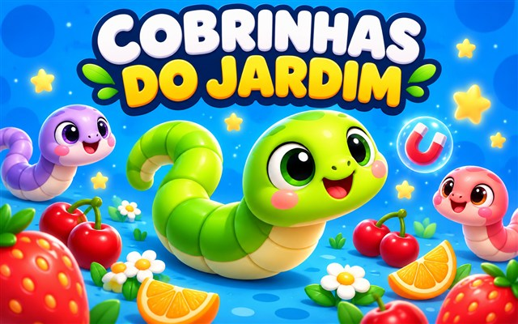

# Cobrinhas do Jardim



Jogo infantil (5+) para DinoPlay, versão 3.0.0, com 12 adversárias do computador. Arena azul, cobrinhas curtas e gordinhas, crescimento em comprimento e grossura, câmara progressiva e comida grande. Bater na borda termina a partida.

## Jogar

Rato, toque/joystick ou setas/WASD para virar. Espaço ou botão de raio para acelerar. Apanha frutas e os pontos deixados por outras cobras. Ajudas temporárias: íman (12 s), binóculos (12 s) e sapatos velozes (8 s).

## Personalizar e descobrir

Oficina com cartões, cores, padrões, olhos, bocas, acessórios, bandeiras e rastos. Oito aventuras finitas, níveis e álbum de autocolantes. Loja de quatro skins por estrelas virtuais obtidas nas aventuras. Roda gratuita com quatro skins, sem repetições, apostas, anúncios ou pagamentos. As opções base do editor estão sempre disponíveis. Sem prazos nem sequências diárias.

## Integração e privacidade

- Runtime sandbox; recorde, visual e progresso usam apenas DinoPlay.storage na app.
- Todos os recursos são locais e constam do manifesto; nenhuma dependência remota.
- Sem multiplayer online, contas próprias, publicidade, pagamentos, chat ou telemetria.
- Pausa ao suspender ou abrir painéis; respeita movimento reduzido.
- A versão autónoma usa um adaptador local próprio, excluído desta contribuição.

## Capa e licença

Capa local cover.jpg: 640 × 400, preparada para o cartão do catálogo. Ilustração criada para este projeto com a ferramenta de geração de imagens da OpenAI; sem utilização de fotografias ou dados pessoais. Código e SVG do projeto disponibilizados sob MIT; a capa é incluída para distribuição com o jogo. Os ícones são SVG originais locais, partilhados pelos menus e pelo canvas.

## Verificação

Na raiz DinoPlay:

```sh
node scripts/validate-catalog.mjs
node scripts/test-cobrinhas.cjs
node scripts/test-cobrinhas-ui.cjs
node scripts/test-cobrinhas-progress.cjs
node scripts/test-cobrinhas-powers.cjs
```

Regras, bordas, crescimento, colisões, ajudas, loja, saldo, prémios únicos e recuperação de progresso testados. Interface verificada no navegador em PC, 320 × 568, 390 × 844 e 844 × 390. Toque em telemóvel físico e modo avião continuam pendentes; os testes de DOM/canvas não substituem essas verificações.

## Ícones locais (3.0.0)

40 ilustrações SVG originais para navegação, frutas, ajudas e acessórios. Não dependem de fontes de emoji, CDN ou bibliotecas remotas. icons.js partilha os mesmos desenhos com os menus e a arena, mantendo os dados de progresso compatíveis. Todos os SVG constam do manifesto offline.

## Idiomas (3.1.0)

O jogo lê `language` do contexto devolvido por `DinoPlay.ready()`: português de Portugal e do Brasil, inglês, espanhol, francês, alemão e polaco. Aberto diretamente, usa o idioma do navegador; `?lang=en` permite escolher um idioma no endereço. Idiomas desconhecidos usam português. Traduções e ícones estão no pacote offline; não há serviços externos. Os IDs e o progresso guardado não mudam.

## Menus e controlos (3.2.0)

Menu com atalhos laterais e cobra em destaque, corpos arredondados, comida maior, resposta mais rápida nas curvas e direção contínua para o cursor. Acelera com Espaço, Shift, clique do rato ou botão tátil. As opções permitem escolher o ritmo e três cenários, guardados no dispositivo. As regras de colisão e os progressos são preservados. A composição inspira-se em jogos de arena de cobras; arte e código permanecem próprios.

## Moedas (3.3.0)

A moeda da loja passa a ser moedas douradas, com ícone SVG local. O saldo das antigas estrelas é preservado. Existem 80 moedas na arena; cada recolha dá uma moeda para gastar na loja, sem alterar a pontuação de fruta. O íman atrai moedas, e as recolhidas reaparecem noutro lugar após 25 segundos. O saldo persiste entre partidas; compras anteriores mantêm-se.

## Painéis arcade (4.0.0)

Roda gratuita com oito prémios em moedas (100, 600, 5000, 400, 500, 10, 200 e 1000), uma oferta por partida sem apostas, anúncios ou pagamentos. Enquanto houver, desbloqueia também uma das quatro skins de oferta antigas. Laboratório com 22 opções, filtros de raridade e pré-visualizações usando o renderizador do jogo; novas texturas de chocolate, milho, cenoura, gelo e gatinho. Resultado de cada eliminação com estatísticas reais, repetir/menu e quatro melhorias até nível 10 por 150 moedas cada (duração dos poderes, alcance do íman e valor das moedas). Compras, melhorias e rotação disponível são guardadas. Mantém os saldos e skins anteriores. A composição segue as referências fornecidas; desenhos e código próprios.

Movimento: a cauda segue o percurso real da cabeça por distância percorrida, incluindo voltas de 360° repetidas. Laboratório com emojis decorativos nas categorias e cartões, conforme pedido.

4.1.0 — Oficina por cartões (corpo, olhos, boca e acessórios); loja com melhorias, reações, efeitos de eliminação e bandeiras. Reações aparecem com E ou botão; efeitos são cosméticos, ativados quando uma cobra do computador choca com a tua. Escolhas e compras são guardadas; moedas apenas do jogo.

4.2.0 — Crescimento contínuo sem limite fixo de segmentos/grossura; bónus repetidos somam duração. WASD/setas/rato orientam; clique esquerdo, Shift e Espaço aceleram (fontes independentes). Menos raízes quadradas repetidas no percurso e colisões.
